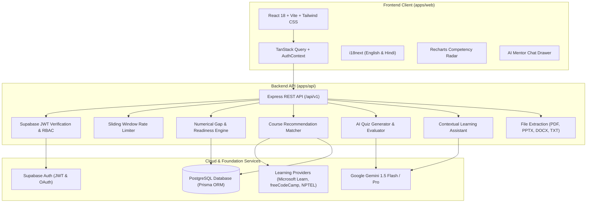

# Skill Setu (कौशल सेतु) — AI Skill Intelligence & Learning Platform

[](https://www.typescriptlang.org/)
[](https://react.js.org/)
[](https://vitejs.dev/)
[](https://tailwindcss.com/)
[](https://expressjs.com/)
[](https://www.prisma.io/)
[](https://supabase.com/)
[](https://ai.google.dev/)

> **Skill Setu** is a production-oriented AI Skill Intelligence & Learning Platform that bridges the gap between where students and professionals currently stand and what high-impact technology careers demand.

---

## 1. System Architecture



---

## 2. Monorepo Structure

```
Skill-Setu/
├── apps/
│   ├── api/                     # Node.js + Express + TypeScript Backend
│   │   ├── prisma/              # Database Schema, Migrations & Seeds
│   │   │   ├── schema.prisma    # PostgreSQL Prisma schema
│   │   │   ├── seed.ts          # Comprehensive seed runner
│   │   │   └── seedData.ts      # 50+ curated courses, roles, diagnostic questions
│   │   ├── src/
│   │   │   ├── controllers/     # Auth, Profile, Competency, Assessment, Quizzes, Chat
│   │   │   ├── middleware/      # Supabase JWT Auth, RBAC, Rate Limiting, Zod
│   │   │   ├── services/        # Gemini AI, File Extraction, Gap Engine, Rec Engine
│   │   │   ├── routes/v1/       # Versioned REST API endpoints
│   │   │   ├── app.ts           # Express application setup
│   │   │   └── server.ts        # Server entry point
│   │   └── tests/               # Vitest unit & integration tests
│   └── web/                     # React 18 + Vite Frontend
│       ├── src/
│       │   ├── components/      # UI primitives, Layouts, AI Chat Drawer
│       │   ├── context/         # AuthContext (Supabase Auth persistence)
│       │   ├── i18n/            # English and Hindi localization bundles
│       │   ├── lib/             # API client, Supabase client, utils
│       │   └── pages/           # Landing, Login, Onboarding, Dashboards, Quizzes
│       ├── tailwind.config.js   # Editorial palette design tokens
│       └── vite.config.ts       # Vite config
├── packages/
│   └── shared/                  # Shared TypeScript Interfaces & Zod Schemas
│       └── src/
│           ├── types/           # Domain models, roles, questions, learning paths
│           └── schemas/         # Zod validation schemas
├── .env.example                 # Safe environment configuration template
├── package.json                 # Monorepo npm workspaces configuration
└── README.md                    # Platform documentation
```

---

## 3. Key Capabilities

### 🛡️ Enterprise Authentication & Security
- Real email/password signup and login through **Supabase Auth**.
- **Google OAuth 2.0** integration ready.
- Verification emails and secure password reset flow.
- Persistent sessions across refreshes with JWT token refresh.
- Server-side verification of Supabase JWTs on all protected endpoints.
- Role-based authorization: `learner`, `trainer`, `admin`.
- In-memory rate limiting with dedicated throttling for AI model generation.
- Prompt injection sanitization for all student inputs to Gemini.

### 🎯 Competency Framework & Gap Scoring
- 7 realistic skill domains and benchmark career roles (Data Analyst, Full-Stack Developer, ML Engineer, Product Manager, Business Analyst, Cloud Architect).
- Proficiency tracked on a verified **1 to 5 scale**:
  $$\text{Effective Proficiency} = 0.4 \times \text{SelfAssessedLevel} + 0.6 \times \text{DiagnosticVerifiedScore}$$
- Numerical gap calculations:
  $$\text{Gap} = \max(0, \text{RequiredProficiency} - \text{EffectiveProficiency})$$
- Overall role readiness score calculated with weighted requirements and priority multipliers (`must_have` = 1.5x, `good_to_have` = 1.0x, `optional` = 0.5x).
- Interactive Recharts **Radar Chart** and ranked gap breakdown.
- AI-synthesized strategic executive summary of top gaps.

### 📚 Course Catalogue & Ordered Learning Path
- 40–60 verified courses from **Microsoft Learn**, **Google Cloud Skills Boost**, **freeCodeCamp**, **NPTEL**, and **CS50**.
- Search, filter by difficulty, language (English, Hindi, Bilingual), provider, and free status.
- Recommendation algorithm matching learner's highest priority gaps.
- Sequential learning path with total hours, status tracking, and direct provider deep links.

### 📝 AI Quiz Generator with Multi-Format File Parsing
- Upload **PDF, PPT/PPTX, DOCX, and TXT** documents (up to 10 MB) or paste study notes.
- Secure text extraction and context chunking.
- Gemini backend model generates single-choice MCQs, multi-choice MCQs, and True/False questions.
- Zod schema validation of generated question structures with automated retry.
- Instant score grading, correct answers, explanations, and weak-topic study recommendations.
- **Printable PDF Export** of quizzes with answer key.

### 💬 Contextual AI Learning Assistant
- Chat tutor powered by Gemini.
- Injects learner's profile, target role, and top skill gaps as contextual directives.
- Rate-limited and prompt-injection sanitized.
- Conversation history persistence.

### 🌐 Internationalization (i18n) & Editorial Design
- Complete bilingual support: **English** and **हिन्दी (Hindi)**.
- Editorial design palette:
  - Background: `#FAF8F4`
  - Text: `#1A1A18`
  - Accent: `#C2410C` (Terracotta)
  - Typography: Fraunces (Headings) and DM Sans (UI & Body).
- Responsive across mobile, tablet, and desktop with Dark/Light theme toggles.

---

## 4. Local Development Setup

### Prerequisites
- **Node.js** >= 18.0.0 (v20+ recommended)
- **npm** >= 9.0.0
- **Git**

### Installation

1. **Clone the repository:**
   ```bash
   git clone https://github.com/anmol200569/Skill-Setu.git
   cd Skill-Setu
   ```

2. **Install all dependencies:**
   ```bash
   npm install
   ```

3. **Configure Environment Variables:**
   Copy `.env.example` to `.env`:
   ```bash
   cp .env.example .env
   ```

   Fill in your credentials:
   - `DATABASE_URL`: PostgreSQL connection string (Supabase or local Postgres).
   - `SUPABASE_URL`: Your Supabase project URL (e.g., `https://xyz.supabase.co`).
   - `SUPABASE_ANON_KEY`: Supabase anon public key.
   - `SUPABASE_SERVICE_ROLE_KEY`: Supabase service role key (backend only).
   - `GEMINI_API_KEY`: Google AI Studio Gemini API key.

4. **Initialize and Seed the Database:**
   ```bash
   # Generate Prisma client
   npm run prisma:generate

   # Apply migrations or push schema
   npx prisma db push --schema=apps/api/prisma/schema.prisma

   # Seed domains, skills, roles, and 50+ courses
   npm run prisma:seed
   ```

5. **Start Development Servers:**
   ```bash
   # Run all apps concurrently (frontend on :5173, backend on :5000)
   npm run dev

   # Or run individually:
   npm run dev:api    # Starts API on http://localhost:5000
   npm run dev:web    # Starts Web on http://localhost:5173
   ```

---

## 5. Automated Testing

Skill Setu includes a comprehensive Vitest test suite covering:
- Mathematical gap analysis formulas and readiness score bounds.
- Course recommendation matching and language preference boosts.
- Zod schema validation of AI quiz JSON outputs.
- Supabase JWT token verification, RBAC authorization, and 401/403 route protection.

Run the test suite:
```bash
npm run test
```

---

## 6. Deployment Guide

### Frontend Deployment (Vercel)
1. Import the repository in [Vercel](https://vercel.com).
2. Set Root Directory to `apps/web`.
3. Framework Preset: `Vite`.
4. Build Command: `npm run build`.
5. Output Directory: `dist`.
6. Configure Environment Variables:
   - `VITE_API_URL`: Your backend API URL (e.g. `https://skill-setu-api.onrender.com/api/v1`)
   - `VITE_SUPABASE_URL`: Your Supabase URL
   - `VITE_SUPABASE_ANON_KEY`: Your Supabase anon key

### Backend Deployment (Render / Railway)
1. Create a new Web Service on [Render](https://render.com) or [Railway](https://railway.app).
2. Root Directory: `apps/api`.
3. Build Command: `npm install && npx prisma generate && npm run build`.
4. Start Command: `node dist/server.js`.
5. Configure Environment Variables:
   - `NODE_ENV`: `production`
   - `PORT`: `5000` (or injected port)
   - `DATABASE_URL`: PostgreSQL connection string
   - `SUPABASE_URL`: Supabase project URL
   - `SUPABASE_SERVICE_ROLE_KEY`: Supabase service role secret
   - `GEMINI_API_KEY`: Google Gemini API key
   - `CORS_ORIGIN`: Your frontend Vercel URL

---

## 7. Troubleshooting

| Issue | Resolution |
|---|---|
| **PowerShell script execution disabled** | Use `npm.cmd` or run `Set-ExecutionPolicy -Scope Process Bypass` in your terminal session. |
| **Prisma database connection error** | If running offline, test mode automatically mocks external databases. For live runs, ensure your Supabase connection string is valid and URL-encoded. |
| **Gemini API quota or missing key** | When `GEMINI_API_KEY` is not provided or in test mode, the built-in fallback intelligence engine generates realistic mock quizzes and responses. |


---

## License & Credits

Built for learners, educators, and technology professionals. Licensed under the MIT License.
